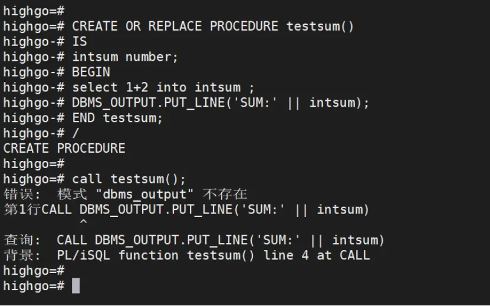
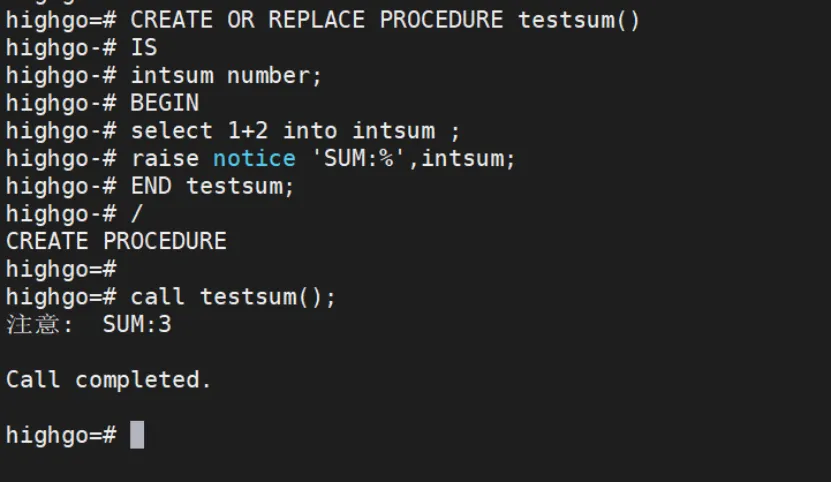
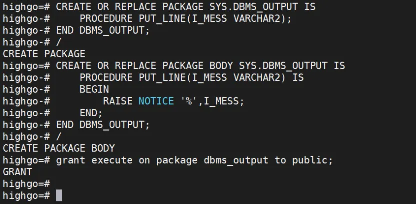
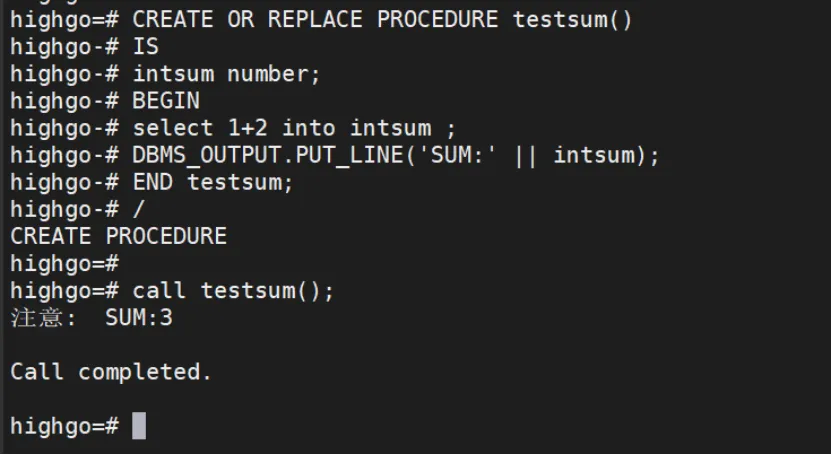

##### 问题现象

在存储过程调试的时候使用DBMS\_OUTPUT.PUT\_LINE来进行打印输出报错。

```bash
CREATE OR REPLACE PROCEDURE testsum()
IS
intsum number;
BEGIN
select 1+2 into intsum ; 
DBMS_OUTPUT.PUT_LINE('SUM:' || intsum);
END testsum;
/
#调用
call testsum();
```



##### 解决方案

###### 使用raise notice替换

DBMS\_OUTPUT.PUT\_LINE(‘SUM:’ || intsum); 改成 raise notice ‘SUM:%’,intsum;



###### 创建一个同名的存储过程

```bash
CREATE OR REPLACE PACKAGE SYS.DBMS_OUTPUT IS
    PROCEDURE PUT_LINE(I_MESS VARCHAR2);
END DBMS_OUTPUT;
/
CREATE OR REPLACE PACKAGE BODY SYS.DBMS_OUTPUT IS
    PROCEDURE PUT_LINE(I_MESS VARCHAR2) IS
    BEGIN
        RAISE NOTICE '%',I_MESS;
    END;
END DBMS_OUTPUT;
/
grant execute on package dbms_output to public;
```



