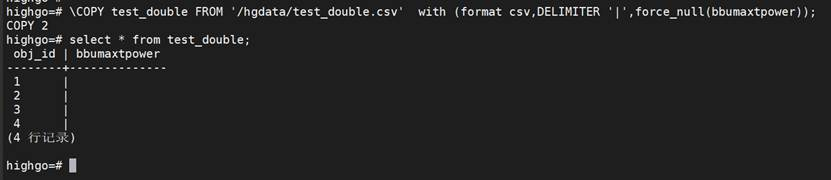
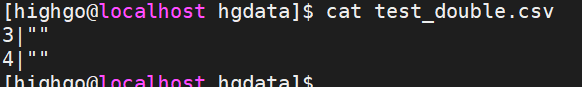

## copy问题

1. 问题1

表字段个数和copy的文件里面列个数不一样时，用copy导入报错。

比如表t\_copy中有5个字段，表t\_copy2中有三个字段。目前表t\_copy数据已经导出到csv文件，现在想把导出的csv文件导入到表t\_copy2中。

(1).表结构和数据

CREATE TABLE t\_copy(id number,c1 varchar2(20),d varchar2(20),e varchar2(20),f varchar2(20));

insert into t\_copy SELECT x,’c1-‘||x,’d1-‘||x,’e1-‘||x,’f1-‘||x FROM generate\_series(1, 10) AS x;

select \* from t\_copy;

CREATE TABLE t\_copy2(id number,d varchar2(20),f varchar2(20));

select \* from t\_copy2;

(2).表t\_copy数据导出

\\COPY t\_copy TO ‘/hgdata/t\_copy.csv’ with DELIMITER ‘|’;

(3).导入数据到t\_copy2

\\COPY t\_copy2 FROM ‘/hgdata/t\_copy.csv’ with csv DELIMITER ‘|’

直接导入会报错：

解决方式，增加skiplist参数跳过不需要的行：

\\COPY t\_copy2 FROM ‘/hgdata/t\_copy.csv’ with csv DELIMITER ‘|’ skiplist 2,4;

select \* from t\_copy2;

2. 问题2

表字段类型是number，导入csv中存在””的数据，用copy导入数据时报错。

比如表test\_double有两个字段，类型都是number。

(1).表结构和数据

create table test\_double(obj\_id number PRIMARY key,bbumaxtpower number);

insert into test\_double values (1,’’),(2,null);

select \* from test\_double;

(2).csv内容

cat test\_double.csv

(3).导入数据到test\_double

\\COPY test\_double FROM ‘/hgdata/test\_double.csv’ with DELIMITER ‘|’;

直接导入会报错：

解决方式，增加force\_null参数把带引用的空值字符串数据值转换成NULL：

\\COPY test\_double FROM ‘/hgdata/test\_double.csv’ with (format csv,DELIMITER ‘|’,force\_null(bbumaxtpower));

select \* from test\_double;

