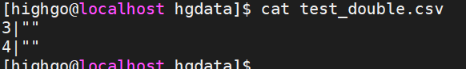
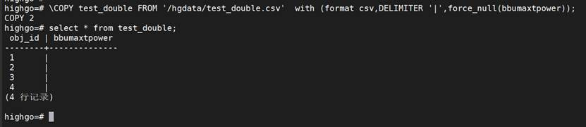

## decode函数问题

1. 问题现象

V9在使用decode函数时，不支持decode里面有子查询

(1).Oracle原语句1：

with city as

(

select ‘370102’ as cityid from dual

union

select ‘370103’ as cityid from dual

union

select ‘370104’ as cityid from dual

)

select cityid, DECODE(cityid, ‘370102’, ‘历下区’, ‘370103’, ‘市中区’, ‘其他区域’) as cityname

from city;

(2).Oracle原语句2：

with info as

(

select ‘01’ as code, 101 as flowid from dual

union

select ‘02’ as code, 102 as flowid from dual

union

select ‘01’ as code, 103 as flowid from dual

union

select ‘02’ as code, 104 as flowid from dual

),

famopen as

(

select ‘10020’ as acttype, 101 as flowid from dual

union

select ‘12620’ as acttype, 101 as flowid from dual

union

select ‘10020’ as acttype, 103 as flowid from dual

),

fammove as

(

select ‘11040’ as acttype, 102 as flowid from dual

union

select ‘10550’ as acttype, 102 as flowid from dual

union

select ‘8904’ as acttype, 104 as flowid from dual

)

select code,flowid,

decode((case when t.code=’01’ then (select max(acttype) from famopen b where b.flowid=t.flowid)

when t.code=’02’ then (select max(acttype) from fammove b where b.flowid=t.flowid)

end),’10020’,’新装’,’12620’,’移机’,’10550’,’主动拆机’,’8904’,’欠费强制拆机’,’11040’,’产品变更’) as atp

from info t;

(3).分别在V9执行上面oracle原语句：

语句1执行结果：

语句2执行结果：

(4).问题

根据结果发现oracle原语句2直接执行报错，错误: unexpected non-SELECT command in SubLink，V9中的decode不支持子查询

2. 解决方案

修改oracle原语句2中的decode为case when，并重新执行

with info as

(

select ‘01’ as code, 101 as flowid from dual

union

select ‘02’ as code, 102 as flowid from dual

union

select ‘01’ as code, 103 as flowid from dual

union

select ‘02’ as code, 104 as flowid from dual

),

famopen as

(

select ‘10020’ as acttype, 101 as flowid from dual

union

select ‘12620’ as acttype, 101 as flowid from dual

union

select ‘10020’ as acttype, 103 as flowid from dual

),

fammove as

(

select ‘11040’ as acttype, 102 as flowid from dual

union

select ‘10550’ as acttype, 102 as flowid from dual

union

select ‘8904’ as acttype, 104 as flowid from dual

)

select code,flowid,

case (case when t.code=’01’ then (select max(acttype) from famopen b where b.flowid=t.flowid)

when t.code=’02’ then (select max(acttype) from fammove b where b.flowid=t.flowid)

end) when ‘10020’ then ‘新装’ when ‘12620’ then ‘移机’ when ‘10550’ then ‘主动拆机’ when ‘8904’ then ‘欠费强制拆机’ when ‘11040’ then ‘产品变更’ end as atp

from info t;

