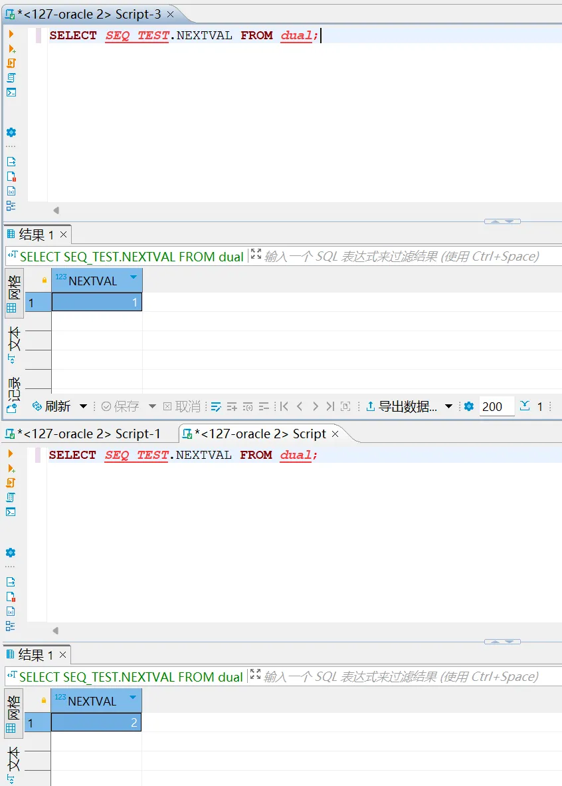
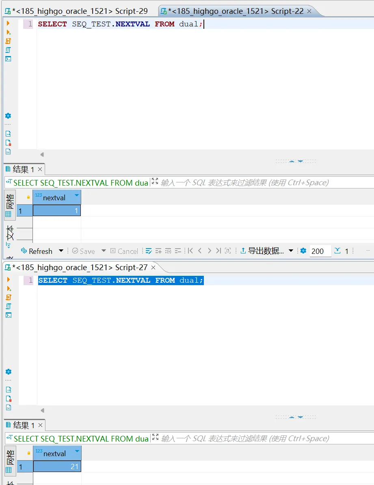
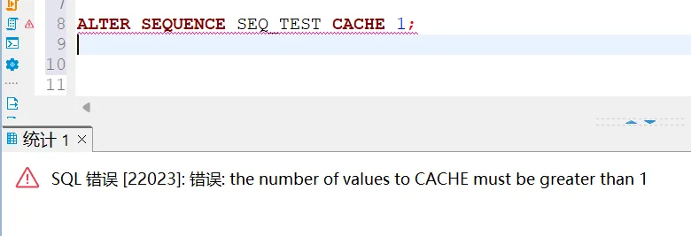
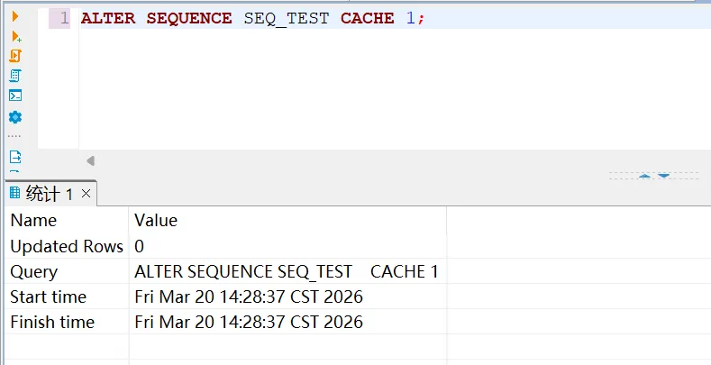
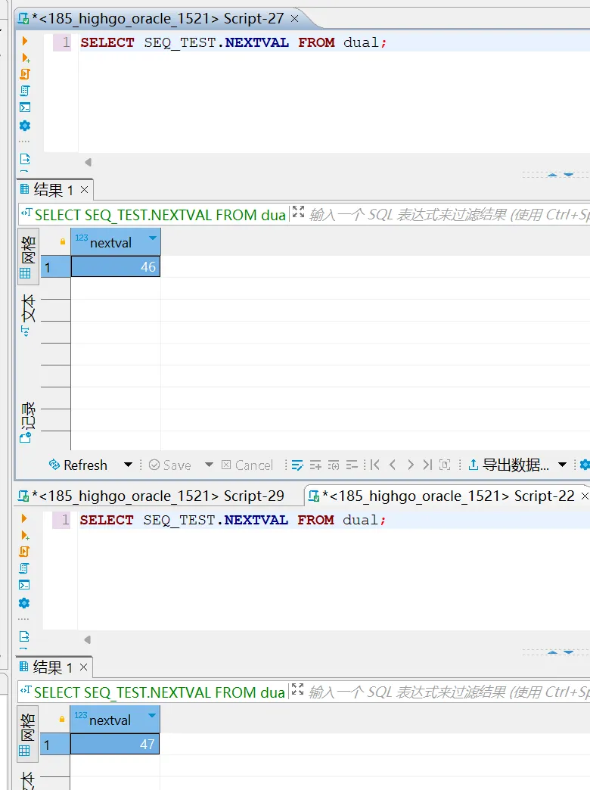

1. 介质名称

hgdbv9-05-0-2-5075-20260113-6552b03-linux.x86\_64.bin

2. 问题现象

hgdbv9的Oracle兼容模式下，序列从Oracle迁移过来之后，在多个会话中执行查询下一个序列值时不连续

(1).序列定义

```sql
CREATE SEQUENCE SEQ_TEST
START WITH 1 
MINVALUE 1 
MAXVALUE 100000000000 
INCREMENT BY 1 
NOCYCLE;
```

(2).Oracle创建后执行并查看结果

```sql
SELECT SEQ_TEST.NEXTVAL FROM dual;
```



通过截图可以看出来，在两个会话中，先后执行查询下一个序列值的操作，下一个序列值是连续的

(3).hgdb创建后执行并查看结果

```sql
SELECT SEQ_TEST.NEXTVAL FROM dual;
```



通过截图可以看出来，在两个会话中，先后执行查询下一个序列值的操作，下一个序列值是不连续的，这是因为迁移过来后，默认缓存是20。在缓存是20的情况下，未做到和Oracle一样序列值连续

3. 解决方案

(1).hgdb修改序列缓存

```sql
ALTER SEQUENCE SEQ_TEST    CACHE 1;
```

通过1521端口无法修改



需要通过5866端口修改



(2).hgdb修改完成后重新执行并查看结果

```sql
SELECT SEQ_TEST.NEXTVAL FROM dual;
```



通过截图可以看出来，在两个会话中，再次先后执行查询下一个序列值的操作，下一个序列值现在是连续的