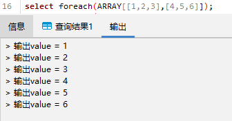
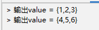

## 循环遍历

PL/pgSQL 中通过 `LOOP` 、 `EXIT` 、 `CONTINUE` 、 `WHILE` 、 `FOR` 和 `FOREACH` 语句，安排 PL/pgSQL 重复执行一系列命令。

### LOOP 与 EXIT

LOOP 与 EXIT 连用的语法如下：

```sql
(1)LOOP
    -- 一些计算
    IF ... THEN ...
    EXIT;  -- 退出循环
    END IF;
    END LOOP;

when
LOOP
    -- 一些计算
    EXIT when count > 0;  -- 退出循环
END LOOP;
```

例如创建一个循环输出1-5的函数：

```sql
CREATE OR REPLACE FUNCTION loop_exit_demo() RETURNS text AS
$$
DECLARE
    num int DEFAULT 0;
    res text;
BEGIN
LOOP
    num:=num+1;
    RAISE NOTICE'loop循环第%次',num;
    IF num > 5 THEN res ='退出循环，res='||num;
    EXIT;  -- 退出循环
    END IF;
    END LOOP;
    RETURN res;
END
$$
LANGUAGE plpgsql;
```

函数逻辑块也可以改写为：

```sql
LOOP
    num:=num+1;
    RAISE NOTICE'loop循环第%次',num;
    EXIT WHEN num > 5 ;
    END LOOP;
    RETURN res ='res='||num;
```

### LOOP 与 CONTINUE

LOOP 和 CONTINUE 连用可以跳过一些语句，当 boolean-expression2 为真时，CONTINUE 生效，会导致循环直接结束，即跳过了某些操作不执行。当 boolean-expression2 为假时，CONTINUE 无效，其后面的一些操作会继续执行。

```sql
LOOP
    -- 一些计算
    EXIT WHEN boolean-expression1;
    CONTINUE WHEN boolean-expression2;
    -- 一些操作
    END LOOP;
```

比如下面的例子，num 位于 \[3,5\] 的结果将被打印。

```sql
CREATE OR REPLACE FUNCTION loop_continue_demo() RETURNS void AS
$$
DECLARE
    num int DEFAULT 0;
    res text;
BEGIN
LOOP
    num:=num+1;
    EXIT WHEN num>5;
    CONTINUE WHEN num<3;
    RAISE NOTICE'continue后循环第%次',num;
    END LOOP;
END
$$
LANGUAGE plpgsql;
```

### WHILE 与 LOOP

WHILE 与 LOOP 连用，可以使表达式在每次进入循环体之前都被检查，只要 boolean-expression 表达式为真，就会进入一次循环体。

```sql
WHILE boolean-expression LOOP
    statements
END LOOP [ label ];
```

例如下面例子中，当 num 不满足小于5的条件，循环停止。

```sql
CREATE OR REPLACE FUNCTION while_loop_demo() RETURNS void AS
$$
DECLARE
    num int DEFAULT 0;
BEGIN
    RAISE NOTICE'while循环开始---';
    WHILE num<5 LOOP
    num:=num+1;
    RAISE NOTICE'loop循环第%次',num;
    END LOOP;
    RAISE NOTICE'while循环结束---';
END
$$
LANGUAGE plpgsql;
```

最后一次进入循环时，num 值为4，执行加运算后，raise 抛出的 num 值为5.

### FOR 与 LOOP

FOR 与 LOOP 的循环有两种用法，整数范围迭代和查询结果迭代。

（1）整数范围迭代：

```sql
FOR name IN [ REVERSE ] beginval .. endval [ BY expression ] LOOP
    statements
END LOOP [ label ];
```

name 变量会自动定义为 integer 并在循环内存在，beginval 和 endval 是 name 循环的开始结束范围，BY 表示步长，默认为1。REVERSE 表示方向，省略则 beginval 到 endval 为增加（每次增加步长值），指定则 beginval 到 endval 为减除（每次减除步长值）。

例如创建例子指定循环范围 \[3,15\]，步长为3，方向为逆向。

```sql
CREATE OR REPLACE FUNCTION for_loop_demo1() RETURNS void AS
$$
BEGIN
    RAISE NOTICE'for循环开始---';
    FOR i IN 3..15 BY 3 REVERSE LOOP
    RAISE NOTICE'i的值为%',i;
    END LOOP;
END
$$
LANGUAGE plpgsql;
```

（2）查询结果迭代：

```sql
--静态
FOR target IN query LOOP
    statements
END LOOP [ label ];

--动态
FOR target IN EXECUTE text_expression [USING expression[,...]] LOOP
    statements
END LOOP [ label ];
```

query 是一条查询语句，它会返回一个查询结果集，target 是一个记录变量、行变量或者逗号分隔的标量变量列表，需要事先定义。在此循环中，每循环一次，target 被赋予来自 query 的一行。

例如将 taret 定义为 record 类型，返回 query 查询结果：

```sql
CREATE OR REPLACE FUNCTION loop_query1() RETURNS void AS 
$$
DECLARE
    v_value record;
    count int default 0;
BEGIN
    RAISE NOTICE '循环开始----';
    FOR v_value IN select * from person LOOP
    count = count + 1;
    RAISE NOTICE '第%次循环，id值为：%',count,v_value.id;
    RAISE NOTICE '第%次循环，name值为：%',count,v_value.name;
    RAISE NOTICE '第%次循环，address值为：%',count,v_value.address;
    END LOOP;
END 
$$
LANGUAGE plpgsql;
```

将上面的例子修改为动态查询：

```sql
CREATE OR REPLACE FUNCTION loop_query2() RETURNS void as 
$$
DECLARE
    v_value record;
    count int default 0;
BEGIN
    RAISE NOTICE '循环开始----';
    FOR v_value IN EXECUTE ' select * from person_' LOOP
    count = count + 1;
    RAISE NOTICE '第%次循环，id值为：%',count,v_value.id;
    RAISE NOTICE '第%次循环，name值为：%',count,v_value.name;
    RAISE NOTICE '第%次循环，address值为：%',count,v_value.address;
    END LOOP;
END 
$$
LANGUAGE plpgsql;
```

### FOREACH 与 LOOP

FOREACH 与 FOR 循环很像，区别在于 FOR 是通过 SQL 返回行进行迭代，而 FOREACH 是通过一个数组值的元素来迭代。

```sql
FOREACH target [ SLICE number ] IN ARRAY expression LOOP
    statements
END LOOP [ label ];
```

当省略 SCLICE 或者 number 为0时，遍历数组个体元素；当 number 为一个不大于数组维度的整数时，FOREACH 会通过 number 的值来对数组进行切片（如 number 为1，则将数组切成多个维度为1的数组；当 numeric 为2时则将数组切成多个维度为2的数组）。

例如创建以下 foreach() 函数，此时变量 x 声明为整数，slice 的数值为0，：

```sql
CREATE OR REPLACE FUNCTION foreach(int[]) RETURNS void AS 
$$
DECLARE
    x int;
BEGIN
    FOREACH x slice 0 in array $1
    LOOP
    RAISE NOTICE '输出value = %',x;
    END LOOP;
END
$$
LANGUAGE plpgsql;
```

执行结果如下：



修改 x 类型为 int\[\] 数组，number 分别为1和2的执行结果如下：

