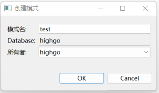
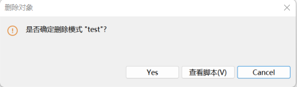
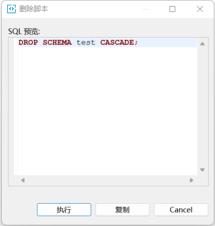
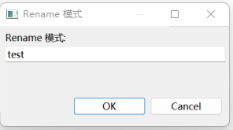

## 数据库对象管理

数据库管理软件能够对数据库对象包括模式表、视图、物化视图、函数、存储过程、触发器、索引、约束、表空间等进行管理，本章节以模式为例，其他数据库对象操作类似。

## 新建数据对象

选择导航数据库连接->具体数据库->模式并右击，选择”新建 模式”选项，弹出创建模式对话框，如下图所示：

图5.1创建模式弹窗

1. 模式名称

输入新建模式名称

2. 数据库

选择模式所属数据库

3. 所有者

选择模式所有者

点击”OK”：创建模式；

点击”Cancel”：取消本次操作。

## 删除数据库对象

选择要删除的数据库对象节点，右击并选择”删除”选项，如下图所示：

 {width=”5.260416666666667in” height=”1.5520833333333333in”}

图 5.2 删除对象弹窗

点击”Yes”：删除数据库对象；

点击”Cancel”：取消本次操作。

点击”查看脚本(V)”：查看本次操作执行的sql，如下图所示：

 {width=”3.682638888888889in” height=”3.8784722222222223in”}

图 5.3 查看删除脚本弹窗

## 重命名数据库对象

选择要删除的数据库对象节点，右击并选择”重命名”选项，如下图所示：

 {width=”2.716666666666667in” height=”1.4673611111111111in”}

图 5.4 重命名数据库对象弹窗

输入对象新的名称，

选择”OK”：重命名数据对象；

选择”Cancel”：取消本次操作。