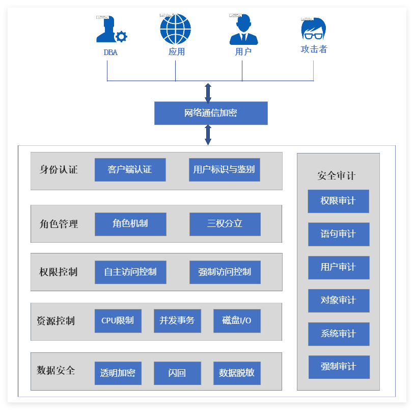

## 概述

本文档主要介绍瀚高数据库管理系统V9.0版本安全体系结构，各安全管理模块的功能、原理及管理员用户和普通用户如何操作以保障数据安全。安全管理适用于瀚高数据库管理系统V9.0及其小版本。

本文档包含了多个SQL代码示例，代码示例以提示符 =# 或=>开始。

## 安全管理

数据库安全管理的核心在于保障数据安全，通过一系列保护措施，确保数据的完整性、保密性、可用性、可控性以及可审查性。数据库中存储了大量重要信息和机密数据，并采用集中存放的方式供多用户共享，这使得数据库面临更高的安全风险。因此，加强对数据库访问的控制和数据安全防护显得尤为重要。瀚高数据库为此提供了全面且丰富的安全管理模块，以满足不同场景下的安全需求。

安全管理功能体系结构，如下图所示：

图1-1 安全管理功能体系结构图